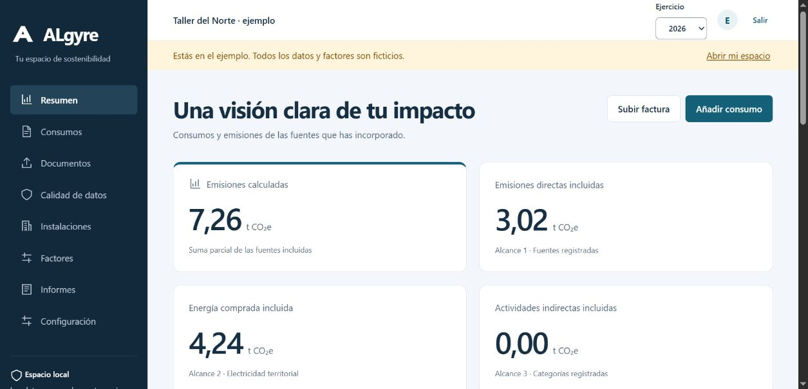

# ALgyre

**Los datos ambientales de tu empresa, en tu ordenador.**

[English](README.md) · [Castellano](README.es.md) · [Instalar](docs/guides/install.es.md) · [Ver pantallas](docs/gallery.md)

Creado por Paco para resolver una necesidad de su empresa: reunir consumos, evidencias y cálculos de emisiones. Descárgalo, elige una contraseña local y empieza. Sin registro ni servidor externo de ALgyre.



*Captura real de la aplicación. Todos los datos y factores son ficticios.*

## Qué puedes hacer

| Recopilar | Revisar | Informar |
| --- | --- | --- |
| Registrar actividades, importar Excel/CSV y adjuntar PDF. | Documentar factores, detectar huecos y consultar correcciones. | Consultar emisiones por alcance y exportar PDF/CSV. |

13 categorías de actividad de los alcances 1, 2 y parte del 3. **Tú aportas los factores documentados.** Sin factor, el cálculo queda pendiente. [Cobertura y límites →](docs/guides/methodology.es.md)

## Empieza en tres pasos

Estas instrucciones son para una primera instalación en **Windows**. Necesitas conexión a Internet durante la preparación.

### 1. Instala Python

Abre el menú Inicio de Windows, escribe **PowerShell** y ábrelo. Copia y pega este comando y pulsa **Enter**:

```powershell
winget install --id Python.Python.3.14 --exact --source winget --scope user
```

Este comando descarga e instala Python y lo añade al PATH, para que Windows pueda encontrarlo cuando abras ALgyre. Sigue las indicaciones que aparezcan.

**Cuando termine, cierra PowerShell y abre una ventana nueva.** Después, comprueba la instalación:

```powershell
python --version
```

Debería aparecer **Python 3.14.x**.

> Si Windows no reconoce `winget`, instala o actualiza **Instalador de aplicaciones —App Installer—** desde Microsoft Store y vuelve a abrir PowerShell.

### 2. Descarga ALgyre

En la nueva ventana de PowerShell, ejecuta estos comandos uno por uno:

```powershell
Set-Location $HOME
```

```powershell
Invoke-WebRequest -UseBasicParsing -Uri "https://github.com/franciscomendoza9069-blip/ALgyre/archive/refs/heads/main.zip" -OutFile "ALgyre.zip"
```

```powershell
Expand-Archive -LiteralPath ".\ALgyre.zip" -DestinationPath "."
```

```powershell
Set-Location ".\ALgyre-main"
```

Estos comandos descargan el proyecto, lo descomprimen en una carpeta llamada **ALgyre-main**, dentro de tu carpeta de usuario de Windows, y abren esa ubicación en la terminal.

> Si ya existe una carpeta `ALgyre-main`, utiliza otra carpeta vacía para esta instalación. Antes de actualizar una instalación existente, guarda una copia de tus datos.

### 3. Abre ALgyre

Ejecuta:

```powershell
& ".\Abrir ALgyre.cmd"
```

El primer inicio prepara la aplicación y descarga las librerías necesarias. Puede tardar unos minutos. Después, ALgyre se abrirá en tu navegador.

Elige una contraseña local o pulsa **«Explorar con datos de ejemplo»** para probarlo con datos ficticios. No necesitas registrarte ni facilitar un correo electrónico.

Tus registros y documentos se guardan en la carpeta `data/`, dentro de la instalación. Las próximas veces, haz doble clic en **Abrir ALgyre.cmd**. Para detener el programa, utiliza **Cerrar ALgyre.cmd**.
## Encuentra lo que necesitas

| Quiero… | Consulta |
| --- | --- |
| Instalar o resolver un problema | [Instalación](docs/guides/install.es.md) |
| Aprender a utilizarlo | [Guía para empresas](docs/guides/usage.es.md) |
| Ver cómo funciona | [Galería de pantallas](docs/gallery.md) |
| Entender los archivos | [Mapa del repositorio](docs/README.md) · [Desarrollo](docs/technical/development.es.md) |

## Licencia

Uso empresarial interno gratuito bajo [PolyForm Internal Use 1.0.0](LICENSE). Puedes modificarlo para ese fin; la redistribución, reventa y oferta como servicio a terceros quedan fuera de los permisos.

© 2026 Paco · [Autor](https://github.com/franciscomendoza9069-blip) · [Cambios](CHANGELOG.md)
