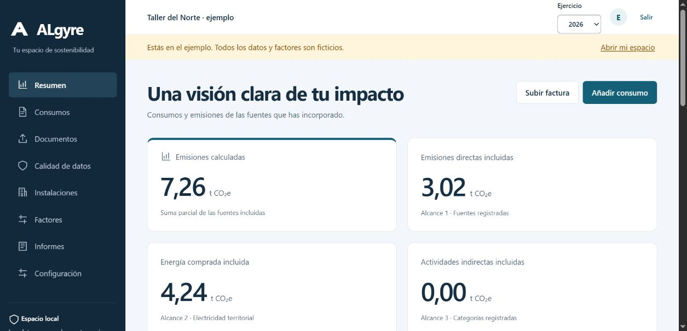

# ALgyre

**Your company's environmental data, on your computer.**

[English](README.md) · [Castellano](README.es.md) · [Install](docs/guides/install.md) · [Screenshots](docs/gallery.md)

Created by Paco to solve a need in his own company: keep consumption records, evidence and emissions calculations together. Download it, choose a local password and start working. No signup or external ALgyre server required.

*Real application, fictional data. The interface currently uses Spanish labels.*

## What it does

| Collect | Review | Report |
| --- | --- | --- |
| Enter activities, import Excel/CSV and attach PDFs. | Document emission factors, check gaps and track corrections. | See calculated emissions by scope and export PDF/CSV. |

13 activity categories across scopes 1, 2 and selected scope 3 activities. **You supply documented emission factors.** Missing factors stay pending. [Coverage and limitations →](docs/guides/methodology.es.md)

## Start in three steps

1. **Download:** select **Code → Download ZIP** and extract the folder.
2. **Prepare:** install **Python 3.11+**, adding it to PATH on Windows.
3. **Open:** on Windows, double-click **Abrir ALgyre.cmd**. For Linux/macOS or manual setup, follow the [installation guide](docs/guides/install.md).

The first setup downloads dependencies. Your data stays in `data/` on your computer. Choose a local password or explore the built-in demonstration.

## Find your way

| I want to… | Open |
| --- | --- |
| Install or troubleshoot | [Installation](docs/guides/install.md) · [Castellano](docs/guides/install.es.md) |
| Learn the daily workflow | [Company guide, in Spanish](docs/guides/usage.es.md) |
| Browse screens | [Screenshot gallery](docs/gallery.md) |
| Understand the code | [Repository map](docs/README.md) · [Development](docs/technical/development.es.md) |

## License

Free for internal business operations under [PolyForm Internal Use 1.0.0](LICENSE). Internal modifications are permitted; redistribution, resale and offering it as a service to third parties are outside the license permissions.

© 2026 Paco · [Author](https://github.com/franciscomendoza9069-blip) · [Changes](CHANGELOG.md)
