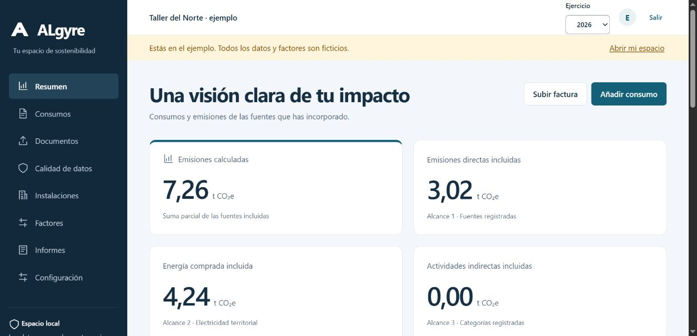
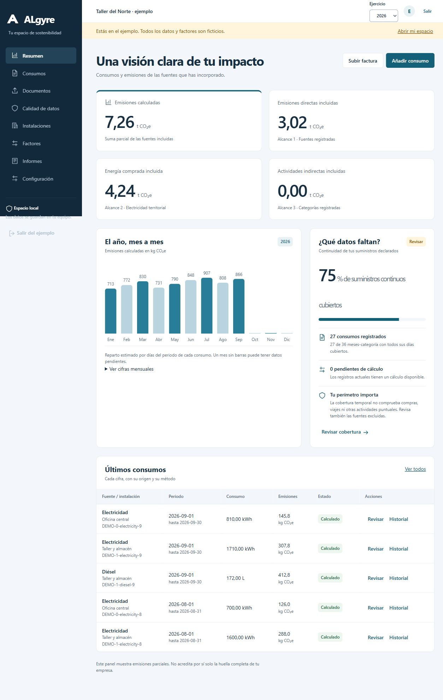
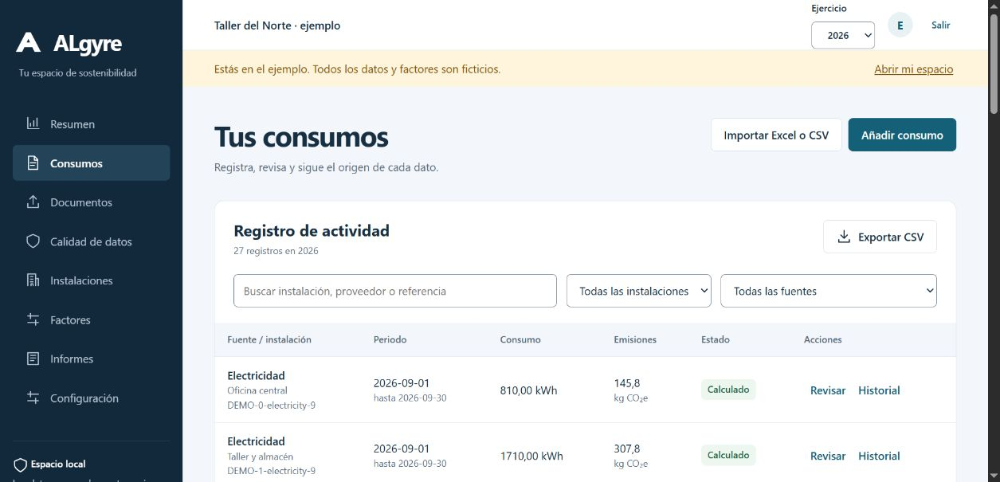
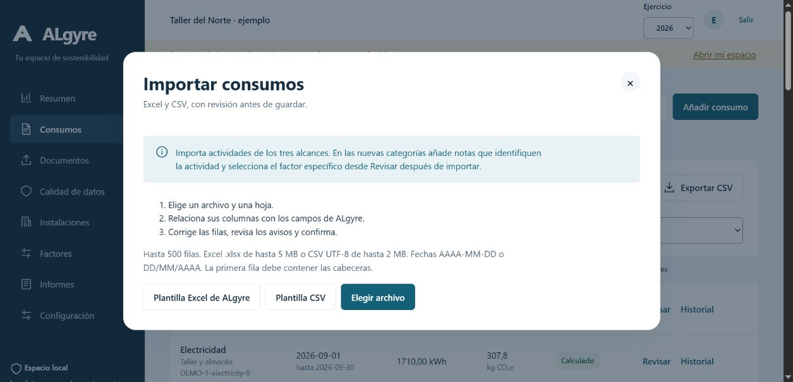

# Inside ALgyre / Así es ALgyre

[English overview](../README.md) · [Portada en castellano](../README.es.md)

Actual screenshots from the built-in demonstration. All companies, activities and factors shown are fictional. The app interface currently uses Spanish labels.

Capturas reales del ejemplo incluido. Todas las empresas, actividades y factores mostrados son ficticios.

## Dashboard / Resumen

Calculated emissions grouped by scope, a monthly view and the continuity of declared supplies.

Emisiones calculadas por alcance, evolución mensual y continuidad de suministros declarados.

Full dashboard / Ver el resumen completo

## Activity register / Registro de consumos

Filter by facility or activity, open a record and inspect its history.

Filtra por instalación o actividad, revisa un registro y consulta su historial.

## Import assistant / Asistente de importación

Import Excel or CSV with a review step before saving. Templates are available in the app.

Importa Excel o CSV y revisa los datos antes de guardarlos. Las plantillas se descargan desde la aplicación.

These images demonstrate the interface, not a complete emissions inventory or a certification. / Las imágenes muestran la interfaz; no representan un inventario completo ni una certificación.
