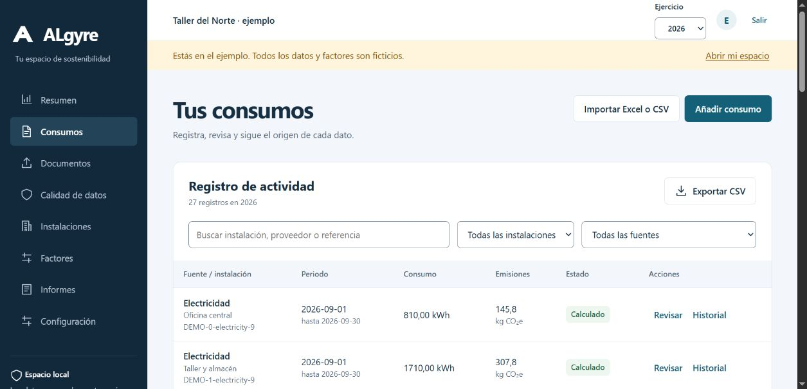

# Empezar a trabajar con ALgyre

ALgyre nació para resolver una necesidad cotidiana de una empresa: encontrar los consumos, saber de dónde sale cada dato y preparar resultados explicables. No necesitas programar para utilizarlo una vez instalado.

## 1. Organiza el trabajo

Designa una persona que revise datos y factores. Decide ejercicio, instalaciones y actividades. Reúne facturas, registros de viajes, justificantes de residuos y documentación de proveedores.

Empieza por una instalación y un mes. Comprueba cantidades y resultados antes de incorporar el resto del año.

## 2. Accede a tu espacio

Descarga y descomprime el proyecto siguiendo el [guía de instalación](install.es.md). En Windows, abre **Abrir ALgyre.cmd**. En Linux o macOS, utiliza los comandos de la guía de instalación.

Abre **http://127.0.0.1:8765** en tu navegador. La primera vez, elige una contraseña local de al menos diez caracteres y repítela. No se pide correo ni registro. En las siguientes visitas introduces esa misma contraseña.

El programa y los datos están en tu ordenador. Debes iniciar ALgyre antes de abrir la página. Guarda la contraseña en tu gestor de contraseñas: este modo no envía correos de recuperación.

## 3. Define qué mides

En **Configuración**, indica nombre, país y ejercicio. En **Perímetro**, describe instalaciones y actividades. En **Exclusiones**, anota fuentes sin evaluar y el motivo.

Ejemplo: «Incluimos oficina y almacén, electricidad, combustibles y transporte contratado. Pendientes compras de materiales y viajes de trabajo».

En **Instalaciones**, crea ubicaciones y activa categorías. Para actividades sin edificio puedes crear un centro como «Viajes corporativos». Su país comprueba la compatibilidad del factor; no determina el lugar de cada viaje.

## 4. Añade factores documentados

Un factor convierte actividad en emisiones. En **Factores**, registra valor, unidad, país, año, fuente, versión y condiciones de uso. El nombre debe identificar producto, refrigerante, transporte o tratamiento.

No inventes factores ni uses los de demostración con datos reales. Si falta uno adecuado, guarda la actividad pendiente. Revisa los límites y evita contar lo mismo dos veces.

## 5. Incorpora datos

En **Consumos**, registra actividad manualmente o selecciona **Importar Excel o CSV**. La plantilla incluye categorías, unidades y ayuda.

1. Elige archivo y hoja.
2. Relaciona columnas con campos.
3. Revisa y corrige filas.
4. Confirma el lote; con errores no se guarda parcialmente.

Para refrigerantes y nuevas actividades, describe el caso en **Notas**. Tras importar, pulsa **Revisar** y elige el factor específico. Un factor de tratamiento de papel no sirve automáticamente para todos los residuos.

Añade PDF en **Documentos**. Contrasta las propuestas con el original. Los escaneos requieren entrada manual. El Excel no se conserva como adjunto: se registra nombre, huella, hoja y fila. Guarda el original en tu archivo empresarial.

## 6. Revisa resultados

El **Resumen** distingue emisiones directas, energía comprada y actividades indirectas. Solo suma registros calculados. Revisa pendientes y **Calidad de datos**.

La cobertura mensual busca días sin datos en suministros continuos. No exige viajes o residuos todos los días ni demuestra que toda la empresa esté inventariada. Contrasta actividades puntuales con sus registros de origen.

## 7. Conserva informes y copias

En **Informes**, crea un PDF con cantidades, factores, fuentes, pendientes y límites. Si corriges datos, genera otra versión: la anterior conserva su contenido.

Descarga el CSV para revisar detalles. En **Configuración**, obtén una copia ZIP con datos y documentos. Trátala como información privada.

## Cerrar, copiar y actualizar

En Windows, cierra el programa con **Cerrar ALgyre.cmd**; si lo arrancaste en terminal, pulsa Ctrl+C. Cerrar la pestaña del navegador no detiene el programa.

Antes de actualizar o cambiar de equipo, descarga una copia ZIP desde Configuración. Instala la versión nueva, crea tu contraseña local y restaura la copia en el espacio correcto. La copia restaura el inventario y los documentos; no traslada la contraseña de la instalación anterior.

## Solo si tu empresa instala un servidor compartido

El modo servidor es opcional y lo instala tu propia empresa. En ese caso, usa la dirección y credenciales que te facilite su responsable, en lugar de la dirección local. El registro de cuentas pertenece exclusivamente a ese modo.

En **Administración**, crea empresas, aprueba solicitudes, abre espacios, suspende accesos y restablece contraseñas. Suspender o cambiar contraseña cierra sus sesiones.

Comprueba el espacio seleccionado antes de eliminar o restaurar. Restaurar sustituye sus datos. Eliminar borra datos activos; las copias generales siguen su retención.
